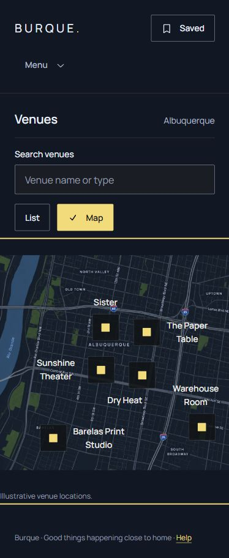

# Audit corrections · Lineup 2.3.2

The user authorized implementation of the completed October 29 UI/UX audit. This application kit demonstrates compositions built from Tide; all 54 events remain authored samples. Tide remains 1.12.0. Only `application-kits/lineup/` canonical sources changed from commit `203c7e2e853365ab1ea7665ea7320fda59ce9660`.

Finding IDs here belong to the October 29 audit, not the older 2.0.4 baseline in AUDIT.md.

| Finding | Correction | Acceptance evidence |
| --- | --- | --- |
| L04 · map targeting | Preserve 44px controls; reserve a minimum frame and separate compact illustrative positions/labels. | 91 browser cases: overview and six selections at thirteen sizes, with no target overlap, label/target collision, clipped labels or horizontal overflow. |
| L01 · empty-state instructions | Zero-result preview explains that there is no event to preview; populated-feed completion text is hidden. | Desktop/phone and all-mode inspection; native recovery opens the 54-card index. |
| L05 · Saved continuity | Both full and concise details expose the existing View saved events link. | All-event render contract plus themed full/concise browser checks; keyboard activation opens Saved. |
| L07 · current List/Map view | Exactly one authored nav state is exposed; a check icon and aria-current location agree with the fragment-selected panel. | All six row→map→row journeys; keyboard List/Map, initial/explicit-list Back and Forward, direct fragments and detail return. |
| L09 · heading context | Generic venue-profile cards use H3 under their H2 collection; month-group cards keep H4. | All-profile render contract; browser heading outlines and unchanged title typography. |
| L02 · venue destinations | Every event links its venue to the matching existing authored venue page. | All-event render contract; native full/concise venue journeys; repository local-reference checks. |
| L08 · Saved copy | Keep the shortlist introduction; omit duplicate footer reassurance. | Copy regression and themed desktop/phone inspection. |

L03 (missing live practical information) and L06 (the Reset/Back-only submission specimen) remain contextual boundaries. No backend, browser runtime, ticketing, persistence or in-product developer notice was added.

## Browser evidence

Chromium on Windows, October 29, 2026. Map sizes: 320×480, 320×800, 390×844, 543×900, 544×900, 844×390, 959×900, 960×900, 1024×1058, 1199×640, 1200×640, 1440×400 and 1440×900. The 140 additional theme cases cover seven affected page/state types at 390px and 1440px in all five themes and both modes. No horizontal overflow or sampled text clipping was found. Each full/concise event had its Saved utility. Map overview and selection checks passed across those modes.

The keyboard history test initially exposed a focus-based map override; removing it made the URL fragment the single view source. Final Back/Forward evidence is retained separately from the failed intermediate run. Runtime measurements and screenshots are under ignored `build/qa/lineup-audit-fixes/`; the [compact retained record](verification/audit-corrections-2026-10-29.json) distinguishes final verification from intermediate captures.

## Build, checks and boundary

`npm run build` and the full `npm run check` passed: 72 Tide tests, 54 application tests and 7 HTTP tests (133 total). The HTTP suite passed with approved local-loopback access. All 196 protected files outside Lineup retain their original SHA-256 hashes. Generated application CSS is 21900 bytes raw and 4037 bytes gzip, within the existing limits. All 54 event routes also passed phone checks for Saved, the correct venue link and layout. Measured card titles remain 24px/32px at weight 580. The initial run passed all 72 Tide and 54 application contract tests but found an application CSS size overrun and sandbox loopback EACCES. The CSS was consolidated within its existing budget; no budget limit or shared tool was changed.

## Consumer notes

- Refresh Lineup's five registered style modules, affected templates, renderer and fixture data together. Card rendering now takes a validated heading context; the default remains H4 and generic venue profiles request H3.
- Both presentation definitions enable the existing Saved control. New venueHref values point only to existing native documents.
- Venue view-state wrappers are private application composition. One state is hidden from layout, keyboard traversal and the accessibility tree. No dynamic aria-current mutation or JavaScript is required.
- Private CSS grouping and centered point positioning preserve the Tide control dimensions and accepted application layout. Long-standing desktop/Saved/month geometry is retained.

## Limits

This is Chromium verification, not an accessibility certification. Firefox/Safari, physical devices, screen readers, actual zoom/text enlargement, text-spacing overrides, runtime forced colors/reduced motion and exhaustive photographic/native-control contrast remain unverified. No live event or venue completeness claim is made.

