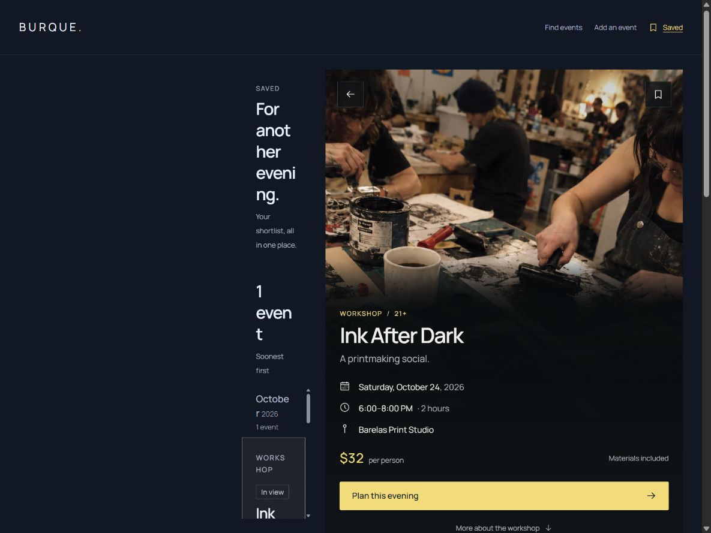
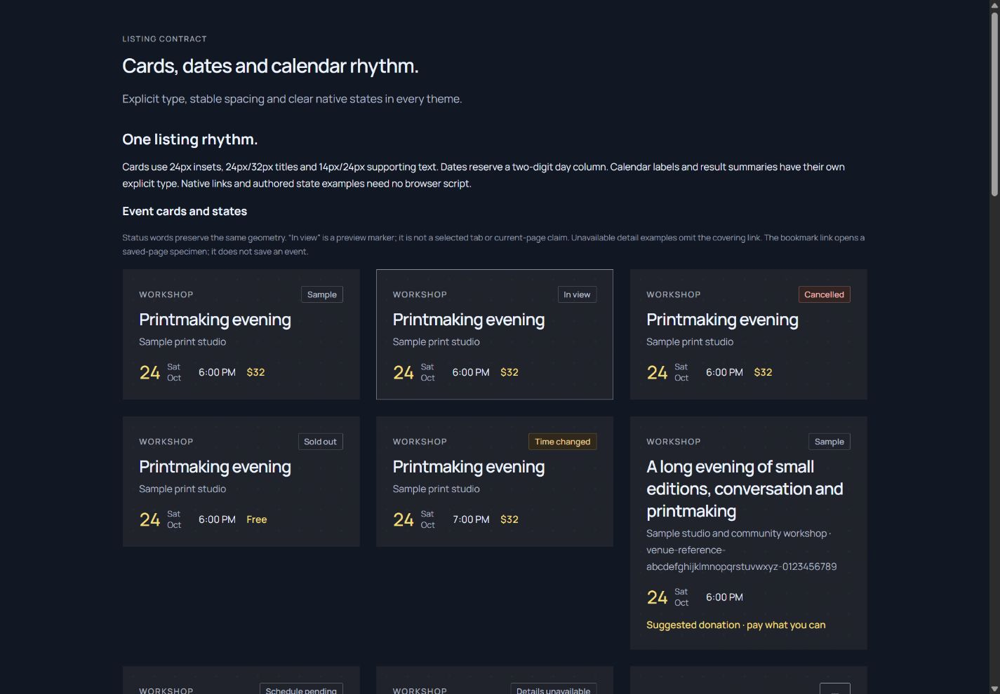
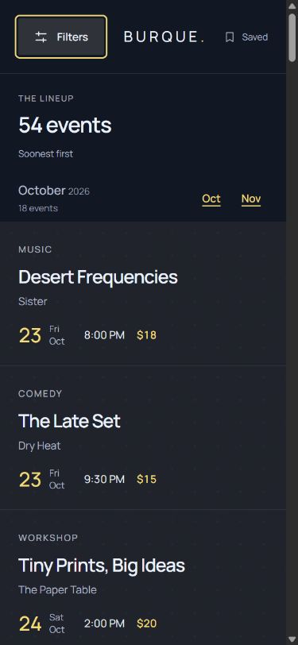

# Lineup application-kit audit · 2026-10-27

Current status: **Lineup 2.1.5 implements the selected compact utility headers**; see the [composition contract](COMPACT-HEADERS.md) and [visual QA](../design-qa.md). The [2.1.4 handoff](HANDOFF.md) still describes product-copy and native HTML/CSS boundaries. Strict Tide alignment completed in 2.1.3; see the [completion boundary and verification](TIDE-ALIGNMENT.md). Previously, the [fresh Lineup 2.1.1 audit](FRESH-AUDIT.md) independently confirmed the six original fixes. Its R01/R02 follow-ups are [resolved in Lineup 2.1.2](FILTER-FOOTER-TABLET.md). This document retains the original 2.0.4 baseline.

Lineup **2.0.4**, layout family **option 1**, is the current named application kit derived from **Tide UI 1.10.0**. Burque Events is its sample website. The application sources now live together in `application-kits/lineup/`; `/events/` preview URLs remain stable. The move preserves all application HTML/CSS/assets and all 704 generated route documents. Tide's component sources, tokens, recipes, registry, assets and generated distribution are unchanged; only two integration-test references follow the moved application path. See [move parity](audit/move-parity.json).

This document preserves the **2.0.4 audit baseline** and its original screenshots/measurements. **L01 and L02 are resolved in Lineup 2.0.5**; see [the application-only repair and verification](SAVED-TYPOGRAPHY.md). **L03 and L04 are resolved in Lineup 2.1.0**; see [visible headings and scoped venue recovery](HEADINGS-VENUE-SCOPE.md). **L05 and L06 are resolved in Lineup 2.1.1**; see [canonical navigation and descriptive titles](NAVIGATION-TITLES.md). All six findings from this baseline have recorded application-only resolutions. The historical observations below remain unchanged in meaning; source checks alone are not browser or assistive-technology coverage.

## Scope and inventory

The user goal is a consumer starting point built from the UI kit, with separate application ownership and independent versions. Review covers event discovery, native filters, event details, venue information, Saved, authored result states, help and submission specimens. See the [starter](STARTER.md) and [ownership contract](COMPONENT-OWNERSHIP.md).

| Surface | Canonical application source | Responsive behavior |
| --- | --- | --- |
| All/search and three category collections | `data/pages.json`, `event-list.html`, `month-group.html`, `event-card.html` | One document below 60rem; list/detail split from 60rem; permanent filters plus list/detail from 75rem |
| 54 event details, full/concise presentations | `data/events.json`, `data/detail-presentations.json`, `event-detail.html` | Full-screen event reading below 60rem; paired list/detail above |
| Sunshine Theater, six authored events | Route context plus `src/pages/sunshine-theater.html` | Information after the feed on phone/portrait tablet; paired information at wider sizes |
| Saved, one authored event | Saved route context and workspace partials | One column below 60rem; split above, with a confirmed failure at the 75rem boundary |
| Authored empty result | `search-empty` route, `empty-results.html`, `preview-state.html` | Recovery content, no cards, placeholder preview where the split exists |
| Help and submission | Two unique fragments; eleven registered form fields | Reading/form columns; container-based field rows |
| Theme/mode review entry | Application builder | Links to all five themes in both modes |

There are 64 native routes per output: 54 details, six original non-event routes and four result specimens. All 64 use one document shell; 62 workspace routes use one workspace. Five registered application stylesheets own private layout; 58 registered HTML partials and three unique fragments own markup. No browser JavaScript is shipped. Search/date inputs, saved state and submissions remain explicitly authored/native UI specimens, not operational services.

Current-run evidence: 20 inspected screenshots; 96 geometry/heading cases across 12 representative routes at 320, 390, 768, 1024, 1199, 1200, 1440 and 1920 CSS pixels; 60 cases covering index/venue/Saved at 390 and 1440 in all ten theme/modes; and 108 cases covering every event at 390 and 1440. Heights are 844 below 600px and 1000 otherwise, with dedicated 1024×900 and 1200×900 screenshots. [Compact browser evidence](audit/browser-evidence.json) records measurements. Full-resolution screenshots, expanded matrices and the step-by-step report are local generated artifacts at `build/qa/lineup-audit/`; open `/qa/lineup-audit/report.html` with the preview server.

## Findings and application-only follow-ups

### L01 · Resolved in 2.0.5 · Saved desktop breakpoint

At 1199px the Saved list is 390px wide. At 1200px it shrinks to **117.6px**, with text fragmented into several lines and a large unused first column. At 1440px it remains unnecessarily offset, with a 319.6px list. There is no document horizontal overflow: an overflow-only test misses this failure.

Cause: `src/styles/desktop.css` gives the non-column workspace two explicit tracks but places results/detail in grid columns 2/3. The implicit third track consumes the reading column; the fixed first track is unused. The wider 90rem rule changes the first track without removing the incorrect placement. Saved's intrinsic intro/summary/feed rows are correctly separated; this is a different grid-column defect. Fix only the application grid and verify 1199/1200/1440/1920, long titles and native feed scrolling. Preserve Tide components.

### L02 · Resolved in 2.0.5 · Private component aliases

The same elements carry public Tide and private Lineup classes. Rules in `src/styles/lineup.css` change the public slot through its private alias; selector-only ownership checks do not join CSS selectors to composed markup.

| Shared element | Tide 1.10.0 recipe | Lineup 2.0.4 baseline |
| --- | --- | --- |
| `tide-results` + `tide-lineup__summary` / `__heading` | 14px/24px; 16px/24px block/inline padding | 12px/24px; 24px top, 16px bottom, 24px inline padding |
| `tide-results__count` + `tide-lineup__heading-title` | 14px/24px inherited result type | 28px/36px page-title type |
| `tide-event-group__title` + `tide-lineup__month-title` | 14px/24px | 16px/24px |
| `tide-event-group__header` + `tide-lineup__month-header` | Neutral bottom hairline | Border removed |

The 28px result-count type repeats in every measured theme/mode. The independent page heading can remain application-owned; it should not silently restyle a registered component slot. Follow-up: choose an application page heading composed beside a canonical result summary, remove aliased component appearance overrides, and keep only viewport/placement/sticky inputs in application CSS. Reconcile the token-based month-target clearance when changing summary rhythm. Add application-level rendered guards for elements bearing both public and private classes. Do not broaden Tide exceptions or change Tide to match the application.

Measured card type remains aligned: 24px/32px title, 14px/24px metadata, 12px/20px category and 24px card padding. Legacy category Eyebrow and hidden metadata-separator markup are explicitly supported by [the listing contract](../../../packages/tide/docs/LISTINGS.md); they are adoption opportunities, not confirmed visual defects. Shared fields measured 48px with 16px values; the primary event action measured 48px. Default standalone venue-profile padding is appropriate here; the newer flush-inline variant is not required by this unpadded application host.

### L03 · Resolved in 2.1.0 · Visible browse headings

On browse/category/empty/venue pages below 75rem, the only h1 is inside the closed popover. At 390px the first exposed heading is the h2 result count, followed by h3 months. The region's accessible label also points to the hidden drawer heading. This is a heading/navigation clarity risk, not a claim of full accessibility failure. The phone event pages, Saved, help and submission expose their own h1.

Follow-up: place the primary page heading and useful context in the ordinary application document at every width, using one authored semantic source and responsive application layout. Keep the filter launcher/panel for controls. Check heading navigation and region names with a screen reader, rather than adding a second h1/control set to the drawer. The [shared shell and heading partials](TEMPLATES.md) own this application change.

### L04 · Resolved in 2.1.0 · Venue result-state scope

On Sunshine Theater, the Music/Comedy/Workshops/No results links in `src/templates/filters.html` point to global `search-*.html` documents, whose route contexts use collection `all`. For example, Comedy leaves the venue and shows 13 global samples. Only “All events” makes the exit explicit. There is no authored venue-filtered empty document demonstrating that useful venue information remains available during recovery. A hidden venue form field does not change these native link destinations.

Phone venue information remains present, beginning about 1658px below the top of the 390px document after six cards; there is no early native jump to it. The desktop information panel remains useful and unframed, with attributed venue facts and clear sample notices. Follow-up: author scoped result/empty states and explicit return/exit links in application route contexts, preserve the venue information, and add a visible phone “About this venue” fragment link. This needs no UI-kit changes or live matching engine. See the [page-recipe venue contract](../../../packages/tide/docs/PAGE-PATTERNS.md#venues).

### L05 · Resolved in 2.1.1 · Retired layout names in page titles

Saved/help/submission browser titles still start with “Workbench / Half Split / Contained / Margin Reveal”. These obsolete study names do not describe Lineup's current layout. Correct the three `documentTitle` values in `data/pages.json` in a follow-up application patch. This audit intentionally retains native-document byte parity. The 2.1.1 complete title scan also found and corrected the same prefix on 48 native event documents; all other event fields remain unchanged.

### L06 · Resolved in 2.1.1 · Private navigation/helpers duplicate available kit recipes

The header's `tide-app__nav-link` and `tide-app__skip` implement navigation/helper presentation while Tide supplies Site header, Saved link and Skip link recipes. This is a reuse opportunity rather than a claim that application viewport geometry belongs in Tide. Compare the kit recipes with `src/styles/base.css` and `header.html` / `skip-link.html`; adopt compatible shared presentation while keeping responsive placement private. Preserve the native destinations and one control set. No new UI-kit component is necessary for the evidence captured here.

## Flow review

| Step | Current-run screenshots | Health and observed behavior |
| --- | --- | --- |
| 1. Browse from phone through tablet to desktop | 01 desktop, 02 tablet split, 04 tablet portrait, 05 phone list | Layout is readable; bounded panes and natural detail document preserved. L02/L03 remain. |
| 2. Open/use/dismiss filters | 03 tablet drawer, 06 phone drawer | Native open, Reset, Close, Escape and focus return passed at the exercised sizes; exactly one search control. Phone footer stays in the 844px viewport. Non-modal popover behavior is intentional. |
| 3. Open event details and long content | 07 phone event, 08 long full-detail event, 19 desktop category/full detail | Both full/concise presentations remain readable. All 54 events at phone/desktop loaded images and had an exposed h1; no scripts or document overflow found. |
| 4. Explore a venue and its information | 09 phone venue list, 10 phone venue information, 11 desktop venue | Information remains useful; L03/L04 limit heading clarity, scope and phone discoverability. External facts/links were not revalidated by this UI audit. |
| 5. Review Saved | 12 desktop Saved, 13 phone Saved | Phone is readable; desktop fails at 1200px (L01). This is an authored shortlist, not persistent saving. |
| 6. Review category and empty results | 14 desktop empty, 15 phone empty, 19 desktop Comedy | Authored counts, distinct previews and recovery links are visible. L02/L03 apply; no claim of live filtering. |
| 7. Read help and inspect submission controls | 16 phone help, 17 phone form, 18 desktop form | Readable hierarchy and responsive native fields; shared field geometry aligns. L05/L06 remain. No upload or submission was performed. |

Screenshot 20 is the canonical Tide listing comparison, not another application step. The initial transitional tablet capture was rejected and replaced with the stable closed-drawer screenshot. Each accepted screenshot was saved and inspected during this run; old migration/refactor images were not reused as audit evidence.

Native November navigation at 1440px aligned the target and feed at y=249px while the summary stayed at y=117px and the outer page stayed at scrollY=0. Filter Reset cleared entered example text; Close/Escape returned focus to Filters. No document-level horizontal overflow appeared in any of the 264 measured route/theme/event cases. That result does not negate the compressed Saved panel.

## Verification and limits

The move's parity record compares against commit `fec603ff885abbcd6d40cdcdaea1cc6fdb391107`: 73 application source files under `src/`, all 704 application documents, 18 generated kit files and 323 reference-site files are byte-identical. The two kit test edits are exact path substitutions only. App metadata now accurately records Tide 1.10.0 instead of the stale 1.5.3 value; application version 2.0.4 and UI-kit version 1.10.0 are unchanged. Root build/check/package integration follows the new home. Historical provenance paths and tags are retained.

Run root `npm run build` and `npm run check`; the [verification record](audit/verification.json) records final results. The initial pre-move build succeeded. Its check was invalidated when the source move occurred before its subprocess finished; only the final post-move check is acceptance evidence.

Browser measurements/screenshots are in-app Chromium on Windows with CSS viewport emulation. The matrices measure geometry, headings, control count and image/script presence; most cases are not full interaction tests. Pointer/keyboard interactions were exercised only where explicitly stated above. Firefox/Safari, physical touch devices/software keyboards, screen readers, forced colors, zoom/text enlargement, current-run reduced-motion interaction, print, and a complete state/contrast audit remain unverified. Source theme/contrast checks are not assistive-technology evidence. No WCAG conformance claim is made.

L01/L02 are resolved by the [2.0.5 application patch](SAVED-TYPOGRAPHY.md), with rendered comparisons and application regression guards. L03/L04 are resolved by the [2.1.0 heading/venue patch](HEADINGS-VENUE-SCOPE.md). L05/L06 remain application follow-ups. Tide remains the source of truth.

## Venue composition review · 2.3.0

The [native venue directory](VENUE-DIRECTORY.md) adopts existing Tide components without a kit extension. The earlier experimental compact media-row padding and map-specific Panel decoration are not carried into canonical sources. Possible reusable media-card/place-marker APIs remain optional design-system proposals requiring separate authorization; they are not required to complete this layout.

The 2026-10-29 directory-list refinement replaces photo rows with the unchanged home-page listing-card treatment. Tide and individual venue documents remain unchanged. A separate tall-tablet map check at 1024x1058 shows the Warehouse Room marker partly clipped by the existing cover fit; the map rules at that size were not changed by this list task. Retain this concrete issue for the map refinement. Evidence: ignored `build/qa/lineup-venues/list-refactor/map-regression.json`.
