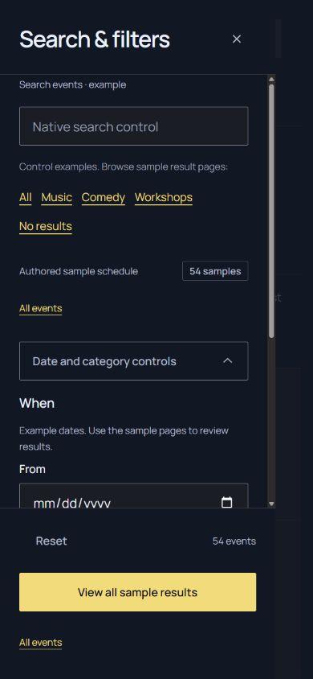
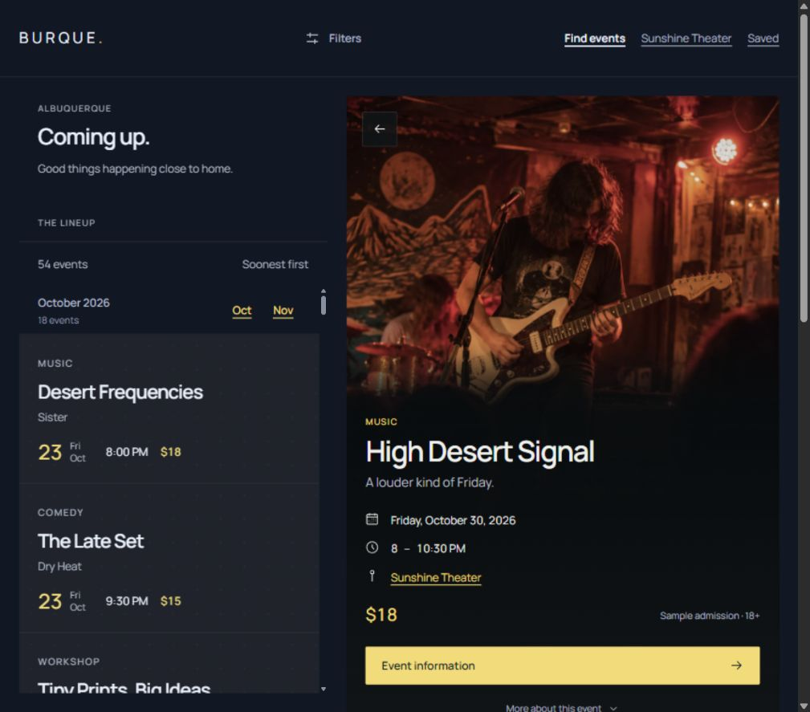

# Filter footer and tablet clearance · Lineup 2.1.2

Lineup 2.1.2 resolves **R02 and R01** from the [fresh 2.1.1 audit](FRESH-AUDIT.md), while consuming Tide UI 1.10.0 unchanged. The [verification record](verification/footer-tablet.json) records the starting commit, shared-source fingerprints and final checks. All canonical changes belong to this application kit.

## Canonical filter internals, private drawer clearance

`filter-rail.html` keeps `tide-filter-panel__footer` as a direct child of `tide-filter-panel--rail`. Tide's direct-child variant therefore still supplies the footer's 16px top / 24px end / 0 bottom-start padding and 16px row gap. There is no private footer alias changing that presentation.

The status row and count use only their public recipe classes. Tide owns their wrapping flex layout, 8px gap, count alignment and text flow. Reset retains its ordinary Button whitespace. The private grid, forced `nowrap`, count alignment/minimum and footer-padding overrides have been removed.

Two ordinary private child wrappers surround the status row and actions, occupying the footer's existing rows. Below 75rem they reserve a 24px start gutter; the actions wrapper also reserves the larger of 24px or the bottom safe-area inset. The rail footer's own end inset balances the other side. These wrappers have no copied grid, gap, font or colour rules. At desktop they add no padding. The native popover remains bounded, with its footer outside the scrolling body and the original control set in place.

This preserves native global form Reset, venue Reset's scoped link, the authored count, native dismissal/focus and already-open drawer resizing. A longer count or Reset label follows Tide's own wrapping rules rather than a private two-track layout.

## Header allowance matches the visible control

The private header-height calculation has one named row-size input. It normally uses Tide's 44px `--tide-size-target`. Between 60rem and 75rem, documents containing the Filters trigger instead use the existing 48px `--tide-size-control` input. The rule lives on the document so its computed allowance is inherited consistently by the header and bounded panes.

At 1024px the filter-page header now reserves **97px**, and a 900px viewport leaves **24px** below the pane. The same clearance holds at 960px and 1199px. Saved and utility headers retain the 44px row input; permanent desktop headers do likewise from 75rem. No shared button size, component padding or browser measurement script is introduced.

## Regression coverage

The application presentation guard still checks shared typography across rendered routes. A new focused guard additionally checks every property on rendered footer/status/count aliases and the Reset data hook, using Tide's existing ownership contract. Negative cases cover padding, grid layout, count alignment and forced Reset whitespace. Private wrappers can supply their own clearance without being treated as public component aliases. This supplements the shared direct-selector checks; it is not a general CSS selector engine.

The repair has **36 application unit tests**. Source tests do not prove viewport geometry, so the browser checks separately enforce the measured 24px clearance and intact native behavior.

## Browser verification

- **240 footer cases:** six route families at 320/390/1024/1440px in all ten theme/modes. Compared 24 computed properties on footer, status, count, Reset and primary action against fresh probes rendered with Tide's canonical rail renderer/CSS: **28,800 property comparisons, no differences**. There are 160 native open-drawer cases; phone event pages retain their accepted header/drawer omission.
- **218 geometry cases:** every native route at 1024×900 and 1200×900, plus nine representative routes at phone/portrait-tablet/split-boundary/wide widths and three routes in 500px-tall windows. Actual dimensions are checked. Bounded results retain at least 24px bottom clearance; headings, control counts, navigation, feed bounds and Saved tracks remain intact.
- Global query/date/category edits reset natively. Escape returns focus to Filters. Native scrolling keeps the footer pinned. An entered value and the single control set survive widening an open drawer to its reserved desktop column; dismissal leaves the desktop panel present and narrowing hides the closed drawer.
- Venue Reset and empty-state recovery remain at Sunshine Theater. Native month targets remain aligned with the document/feed in the checked phone, split-tablet, venue and desktop cases; desktop summary/outer position remain stable.

Expanded measurements and screenshots are ignored artifacts under `build/qa/lineup-2.1.2/`. The two reviewed captures below show the repaired phone footer and split-tablet composition. Root build/check results, including the 36 application tests, are recorded in [the evidence](verification/footer-tablet.json).

Current browser evidence is in-app Chromium on Windows with CSS viewport emulation. Firefox/Safari, physical devices/software keyboards, screen readers, forced colours, text enlargement/zoom, print and current-run reduced-motion interaction remain unverified. Native theme/state coverage is sampled, not an accessibility-conformance claim. Historical audit records remain intact; they describe their earlier baselines.
