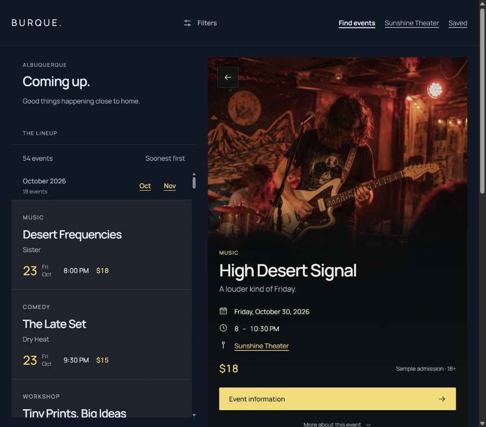
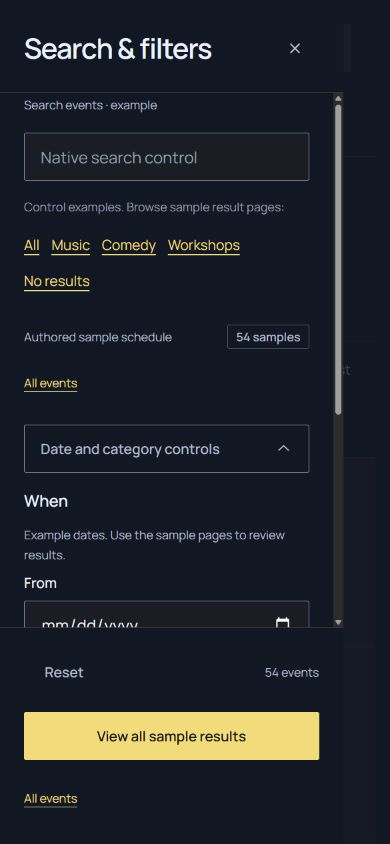
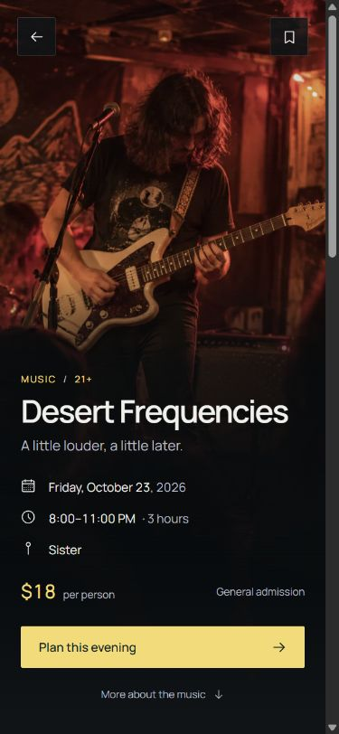
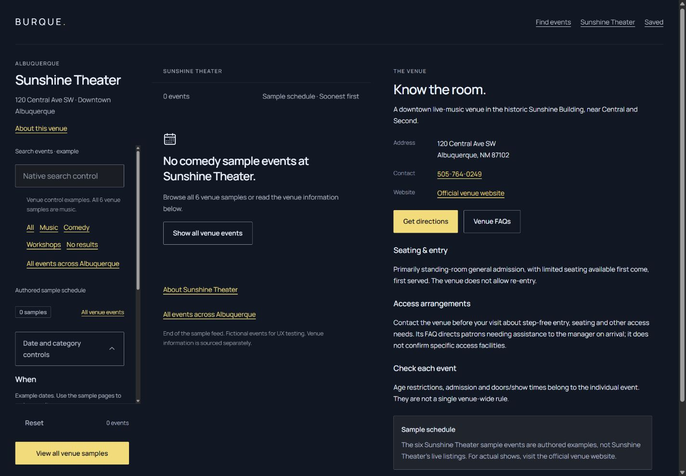
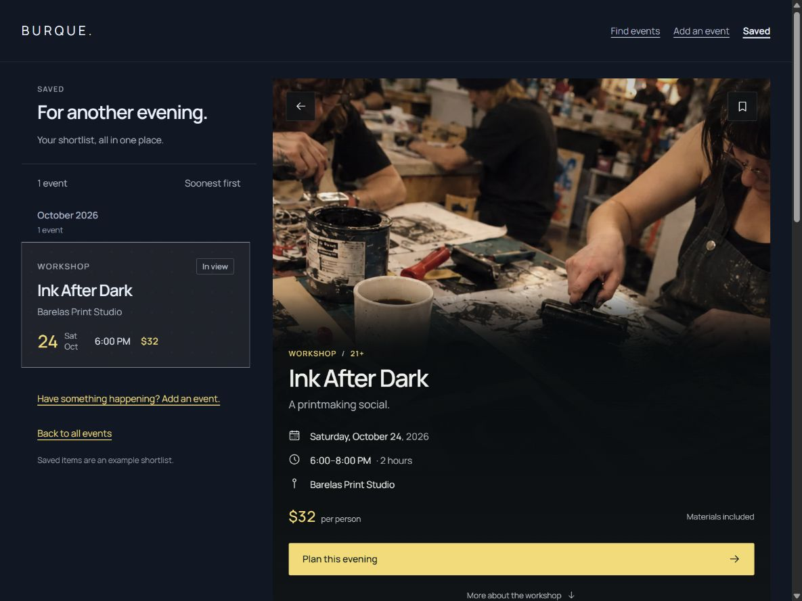
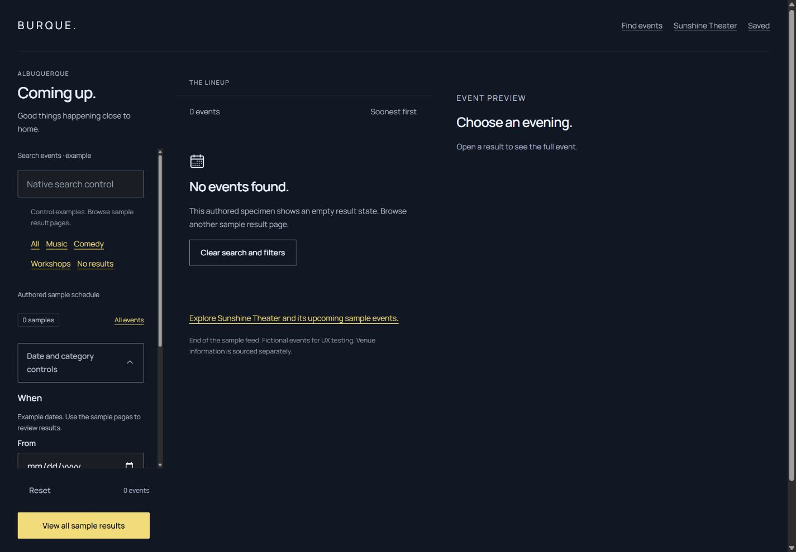
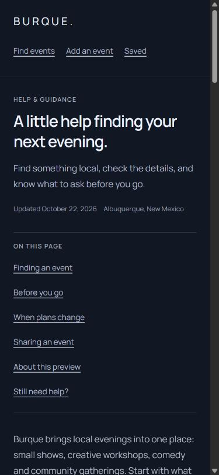
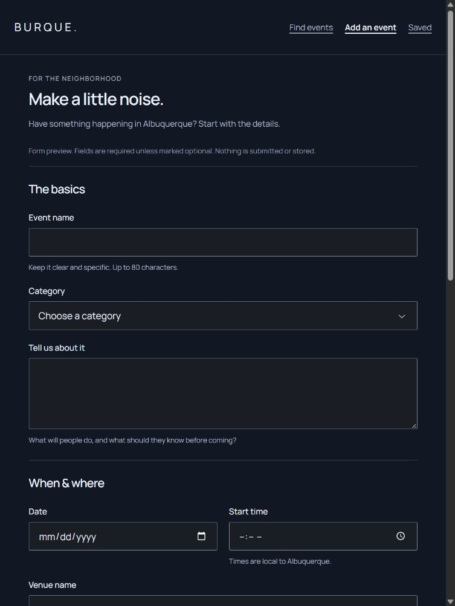

# Fresh responsive audit · Lineup 2.1.1

**2026-10-27 · Tide UI 1.10.0 · baseline `0250809`**

The six fixes from the [initial audit](AUDIT.md) hold in this fresh pass. Saved has its two populated desktop tracks; shared typography matches Tide; browse headings stay outside the closed drawer; venue recovery remains scoped; retired study names are absent from document titles; and the header/skip links consume the canonical recipes. Two application-only follow-ups remain: **R01, split-tablet pane clearance**, and **R02, filter-footer recipe ownership**. No interaction was blocked in the exercised journeys.

This is an audit and documentation update. Application version remains **2.1.1**. Templates, styles, fixtures, assets and tests are unchanged. Tide, the reference site, shared tooling and sibling applications remain read-only. [Machine-readable evidence](audit/fresh-evidence.json) records the starting commit, boundary fingerprints, coverage and actual check results.

## Scope and method

The goal is a reusable application starting point composed from Tide. This pass covers native browsing, filters, full/concise event details, Sunshine Theater and its empty states, Saved, category/global empty results, Help and the submission specimen. Authored sample counts and result pages are intentional; arbitrary matching, persistence and operational submissions are outside scope.

- **279 geometry cases:** all 67 native routes at 390×844, 768×1024 and 1440×1024; twelve representative routes at 320×844 and 960/1024/1199/1200/1920×900; three representative routes at 1200×500 and 1440×500. Actual dimensions are checked in each case. No document overflow, missing/hidden h1, duplicate control set, clipped main navigation or Saved-track failure was found. R01 appears in 27 of the additional breakpoint cases.
- **240 component cases:** eight routes at 390×844, 1024×1000 and 1440×1000 in all five themes/light-dark modes. The 5,970 shared-slot comparisons cover eight type/colour properties, with no typography differences. Internal spacing/layout comparisons isolate R02. This is sampling of 45 roles, not every possible component state.
- **34 keyboard skip journeys:** eight route families at 390/1024/1440, including ten optional split-view preview jumps. Tab reveals the canonical helper; Enter updates the fragment and focuses the intended exposed destination. Native event and Help checks were repeated after scroll settling before acceptance.
- Native journeys cover an event toolbar return, Help contents, global Reset/Escape/focus return, open-drawer resize to desktop, venue information/category/recovery/Reset/city exit, and form labels/native email validity/Reset. The one original filter set and entered value survive resizing; the open desktop panel matches its reserved column exactly.

Only current-run captures and measurements support these conclusions. An existing browser tab was refreshed to the current build. A comparison run with mismatched tab viewports was discarded and repeated in one tab with actual dimensions recorded. Transitional captures/readings were replaced. The regular secondary-button reference was matched to the regular variant; compact-button differences are not drift. Browser-resolved `auto`/`0px` minimums depend on surrounding layout and are excluded from appearance findings. Default versus flush-inline venue padding is a documented recipe choice. The four immediate image reads that were not ready belonged to hidden phone previews; no visible image failure was found.

## Findings

### R02 · P2 · Private aliases still change Filter panel internals

The native drawer remains readable and usable, but its internal presentation is partly forked through private aliases:

| Public slot | Tide rail recipe | Lineup |
| --- | --- | --- |
| `tide-filter-panel__status-row` | Flex, wrapping, 8px gap | Grid with `auto minmax(0, 1fr)` tracks |
| `tide-filter-panel__footer`, below 75rem | Rail padding: 16px top, 24px end, 0 bottom/start | 20px top, 24px inline and bottom safe-area padding |
| Footer count / Reset text flow | Count aligned `start`; Reset whitespace `normal` | Count aligned `end`; Reset forced to `nowrap` |

`src/styles/filters.css` targets `.tide-app__filter-status-row` and `.tide-app__filter-footer` on those same public elements in `filter-status.html` and `filter-rail.html`, plus the count and Reset descendants. The status-row difference appears in all 150 sampled cases containing filters; narrow footer-padding differences appear in 100 of them. The extra count/Reset text-flow comparison uses the Bumble Dark rail probe. Typography remains aligned.

The comparison uses Tide's current `tools/filter_panel.py` renderer and unchanged distribution with the public `--rail` modifier, in an ignored audit-only probe. The default non-rail footer happens to have the same padding as Lineup's drawer, but Lineup still carries `--rail` and overrides it privately. The [Filter panel ownership contract](../../../packages/tide/docs/SEARCH-FILTERS.md#ownership) assigns internal layout to the kit; host ownership covers placement and available height. No registered consumer exception permits these internal overrides.

This is recipe-ownership drift, not an observed blocked action or a claim of accessibility failure. It also explains why a passing check is insufficient: the application alias guard currently inspects typography, while these aliases change layout and padding.

**Application-only follow-up:** restore the canonical status row and footer internals. Put responsive drawer gutters/safe-area reservation in a private outer composition where needed. Preserve the pinned footer, original form/control set, native popover dismissal, scoped Reset and desktop column. Add focused application regression coverage for these internal slots; do not change Tide or weaken its checks. Evidence: step 2 and the component matrix.

### R01 · P3 · Split-tablet pane clearance is about 20px instead of 24px

At 960, 1024 and 1199px on browse/event routes with Filters in the header, the actual header measures approximately **96.67px**. The private `--tide-app-header-block-size` still budgets **93px**, using Tide's 44px `--tide-size-target`. The canonical Filters button uses the 48px `--tide-size-control`. Since the header now grows naturally, the bounded pane starts lower while its available-height subtraction retains the shorter value.

At 900px viewport height the list ends at approximately **879.67px**, leaving **20.33px** below it. The same page at 1200/1440px has a 93px header and the required **24px** clearance. Saved, without Filters in its header, retains the correct clearance. The roughly 3.67px deficit is small; no control or card was clipped in this pass.

**Application-only follow-up:** make the private header-height allowance reflect the 48px control row in the 60–75rem split range, using the existing Tide size inputs. Retain the 44px navigation-row allowance where appropriate. Recheck initial pane fit, native month targets and open-drawer resizing. Do not change Tide button sizing or introduce a browser measurement script. Evidence: step 1 and the five-width pane probe.

## Fresh flow evidence

### 1. Browse · healthy, with R01 at split-tablet widths

Phone and portrait tablet expose the page heading and all three main destinations. Landscape tablet pairs a readable list with the natural right document. Desktop retains its 20/35/45 composition and permanent summary. Native November jumps were checked separately. The landscape example also supplies R01's measured bottom-clearance evidence; the subtle gap difference is established by measurements, not by a screenshot-only estimate.

### 2. Filters · native interactions pass; R02 remains

One non-modal native popover has a scrolling body, visible Close control and pinned footer. Reset clears query/category examples. Escape dismisses and returns focus to Filters. An open 390px drawer resized to 1440px matches its desktop column, keeps the entered value and retains one control set. Native dismissal leaves the desktop column visible; at phone size the closed drawer is hidden. The public footer/status-row aliases remain the ownership issue described in R02.

### 3. Event details · healthy

Native card links open the expected event and retain clean document titles. Phone event reading keeps its accepted full-screen layout and toolbar destinations. The long-title desktop specimen wraps without document overflow. Full and concise details remain covered by the all-route matrix; these checks do not validate authored event facts as live listings.

### 4. Venue scope and recovery · healthy

The early About this venue jump focuses the same document's information at the top of the phone viewport. Comedy opens a venue-owned empty state; venue information remains present. Recovery and Reset return to Sunshine Theater's six samples. Only All events across Albuquerque exits to the 54-event city collection. Main navigation no longer claims the venue owner is the actual current page on a scoped empty document.

### 5. Saved · healthy

At 1200px the list is **352px** wide, followed by the populated detail column; at 1440/1920px it is **390px**. No unused first or implicit third track returns. Intro, summary and feed occupy their intended rows. Phone Saved retains its exposed heading and single authored shortlist entry. This remains a sample, not persistent saving.

### 6. Category and global empty results · healthy

Authored categories retain their expected sample counts and native event links. Global empty results explain recovery and display the preview placeholder in the split layout. Venue empty states keep their own recovery path and information. Counts are authored, not a response to arbitrary input.

### 7. Help and submission · healthy

Help's contents links focus their named sections. The canonical skip link is visible on Tab and focuses main content. The form's thirteen native controls each have one associated label; eleven fields remain registered definitions, with photo/permission markup authored separately. Native email validity identifies a type mismatch; Reset clears the entered examples. No file was selected, uploaded or submitted.

## Checks and limits

The root build/check commands verify generated freshness, zero browser JavaScript, ownership/markup, palette/contrast gates, local references, performance budgets and HTTP contracts. Their actual results are in [the evidence record](audit/fresh-evidence.json). They do not detect the remaining private footer aliases or the small viewport-height deficit.

Evidence is in-app Chromium on Windows with CSS viewport emulation. No Firefox/Safari, physical device/software keyboard, screen-reader, forced-colours, text-enlargement/zoom or print verification is claimed. This run did not exhaust every hover/pressed/disabled state, modified click, outside-dismissal path, reduced-motion interaction or external destination. Native validity was read without invoking a submission. Venue facts were not re-researched. Geometry/type matrices are DOM measurements; the accepted screenshots cover representative journeys, not every matrix cell. This is not a full accessibility-conformance audit.

Routine captures, the canonical rail probes and expanded matrices are ignored artifacts under `build/qa/lineup-fresh-audit/`. A local screenshot report is available at `/qa/lineup-fresh-audit/report.html` while the preview server is running. The accepted screenshots above are retained inside Lineup. The next application pass should address R02 and R01 together while keeping Tide unchanged.
