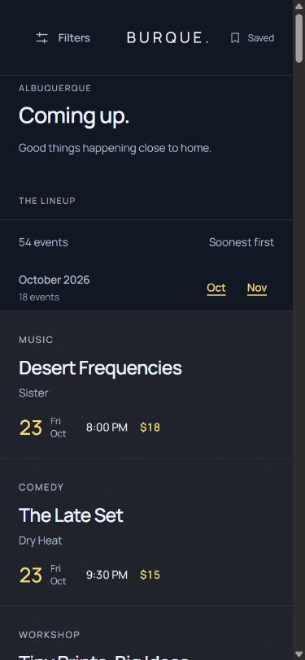
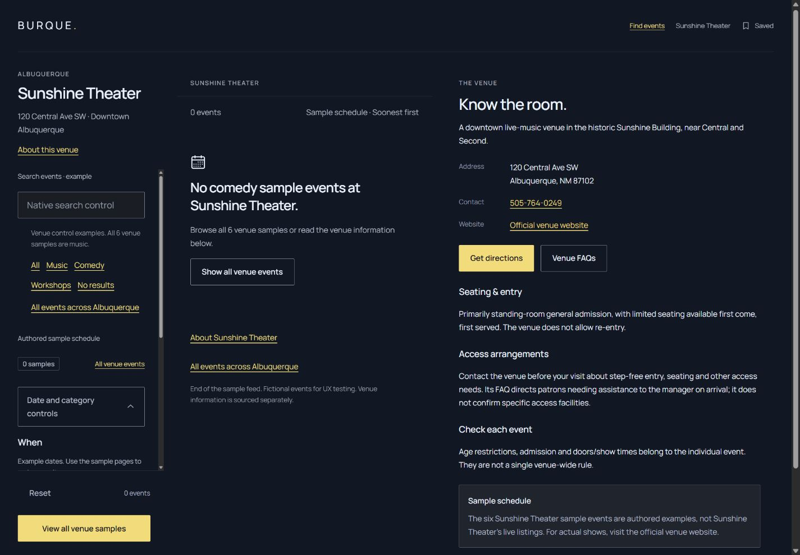

# Visible headings and venue-scoped recovery · Lineup 2.1.0

This application-only change resolves audit findings **L03** and **L04**. Tide UI 1.10.0 and all root/site/shared-tooling sources remain unchanged. Public type and component recipes continue to come directly from Tide.

## One visible heading

`workspace-browse.html` authors one `results-intro.html` inside a private `tide-app__browse-heading` wrapper, outside `#lineup-filters`. The original heading ID and region association remain. Closing the popover no longer hides the page heading. There is no duplicate heading, control set or browser movement script. Native event pages retain their own event h1 and use an h2 for browse context; Saved retains its separate intro.

On phone/portrait tablet, the heading precedes the list in the natural document. From 60rem, the heading and results share a bounded sticky browse column, with a permanent summary above the native scrolling feed. From 75rem, the heading occupies the top of the filter column and the original filter panel fits below it; the result column spans both rows. The 20/35/45 tracks, natural right document and minimum 24px bottom clearance remain.

The desktop heading wrapper can scroll when a short window requires it. Its 40% height cap leaves room for filters and their footer; the h1 remained fully readable in the exercised 500px-high cases. This is private viewport placement, not a type or spacing override on a shared component. The open drawer uses the existing CSS anchor to follow the filter column below the heading when resized to desktop.

## Venue result journeys

All venue result destinations are registered on the venue owner in `data/pages.json`. Each venue page retains its exact `venue` ID, shared information fragment and scoped form action. The renderer rejects destinations that leave that venue or omit its information source.

| Link/state | Native destination and result |
| --- | --- |
| All / Music | `sunshine-theater.html`, the same six music samples. The authored dataset contains only music at this venue, so these identical views deliberately share one document. Validation rejects this alias if non-music venue samples are introduced. |
| Comedy | `sunshine-theater-comedy.html`, an authored empty venue view with the Comedy control checked |
| Workshops | `sunshine-theater-workshop.html`, an authored empty venue view with the Workshop control checked |
| No results | `sunshine-theater-empty.html`, an authored empty venue view |
| Reset | Native link to `sunshine-theater.html`; clears the venue sample view/query and returns to the six venue samples |
| Empty recovery | “Show all venue events” returns to the same venue's result region |
| About this venue / About Sunshine Theater | Same-document `#venue-information`; preserves the selected venue result page |
| All events across Albuquerque | Explicit native exit to the global index |

The venue information remains rendered even when no cards match; the generic preview placeholder stays hidden so it cannot cover that information. The new visible “About this venue” link makes the information reachable before scrolling through the phone list. Venue facts and attribution remain authored and unchanged.

There are now **67 routes**: the original 64 plus three scoped empty views, generated as **737 application documents** across the default app and ten theme/modes. All 67 share one document shell; 65 use the workspace. Sixty registered partials and three unique content fragments retain canonical ownership. No copied shells, raw HTML in JSON, browser scripts or service are introduced.

The global Reset remains a native form-reset button. Venue Reset is a native navigation link, so it can clear an authored category document while retaining venue scope. The “View all venue samples” form uses a local GET to the venue page. As before, query values do not implement matching; arbitrary search/date matching and persistent state remain outside the authored specimen.

## Verification

Current-run Chromium checks cover 300 theme/route/width cases and 3,000 component-style comparisons against fresh canonical Tide references, plus 108 representative cases at 320/390/768/960/1024/1199/1200/1440/1920px. These found one exposed h1 outside the popover, the expected original control count, no horizontal document overflow, bounded panes and useful information on every venue view tested. Saved's two-track layout and Tide typography remain intact.

Native checks cover the phone venue journey (information jump, category links, Reset, recovery, explicit city exit and Back), scoped form navigation, drawer dismissal/focus return and six open-drawer resize cases. At 500px height, four desktop cases retained at least a full regular field's height in the filter body and the footer's 24px bottom clearance.

Sixty native month-jump cases cover index/venue in every theme/mode at 1024/1200/1440px. At split-tablet widths the outer page can naturally scroll its header away while retaining the visible browse heading; its height and the venue information link are reserved in the native target offset. Desktop keeps the result summary/outer position stable. Phone November aligned at the document top. Source tests cover the relocated unique heading, every native event route, scoped destination ownership, scoped reset/recovery, information retention and the global reset distinction.

The [verification record](verification/headings-venue.json) records final build/check results and source fingerprints. Expanded measurements and routine screenshots are ignored local artifacts under `build/qa/lineup-2.1.0/`.

Evidence is in-app Chromium on Windows with CSS viewport emulation. Firefox/Safari, physical devices/software keyboards, screen readers, forced colors, text enlargement/zoom, print, current-run reduced-motion interaction and exhaustive native control states remain unverified. DOM/AX heading checks are not a screen-reader or accessibility-conformance claim. Audit findings L05/L06 remain open; L01–L04 are resolved by the recorded application changes.
