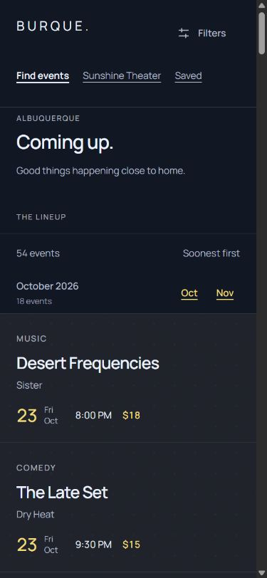
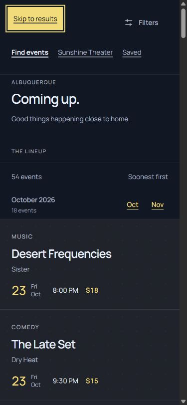

# Navigation and titles · Lineup 2.1.1

Lineup consumes Tide UI 1.10.0 without changing the UI kit. This application-only patch resolves audit findings **L05/L06**. The initial [2.0.4 audit](AUDIT.md) remains historical evidence; the [verification record](verification/navigation-titles.json) records this patch's checks and boundary fingerprints.

## Canonical recipes and application ownership

`src/templates/header.html` now consumes `tide-site-header`, `tide-site-header__links` and `tide-site-header__link` from Tide's [navigation recipe](../../../packages/tide/docs/PAGE-PATTERNS.md#navigation). It uses an ordinary labelled `nav`, `ul`/`li` and native anchors. Find events, Sunshine Theater (or Add an event on utility pages) and Saved retain their destinations. Saved uses the same text navigation recipe as its neighbours. Every link remains available at narrow widths, wrapping through Tide's existing CSS instead of being hidden below 45rem. Filters remains the single native popover trigger.

The UI kit owns navigation type, colour, underlining, current-page treatment, target size, wrapping and internal rhythm. The private header class retains viewport width/insets, safe-area clearance and desktop sticky placement. Its split-view height is a minimum; phone headers grow with wrapped links. The old private navigation rules and duplicate skip-link appearance are removed.

Route context derives `aria-current="page"` only when the document route matches the anchor's destination: index, Sunshine Theater, Saved or Add an event. Result pages, scoped venue empty views, Help and native event details do not identify a different document as current. The former `currentNav` hints are removed from route data. Native links, modified-link semantics and browser history remain browser-owned; there is no menu widget, router or executable dependency.

`skip-link.html` uses `tide-skip-link` and Tide's existing focus presentation. Route labels and fragment IDs remain: results, event/detail preview, venue information or main content. All destinations remain focusable. The private `tide-app__detail-skip` class only controls availability of the optional second jump from the 60rem split breakpoint; native event pages always expose their event jump. No private type, padding, colour or focus-position rule overrides the helper.

## Descriptive document titles

`data/pages.json` now supplies **Saved events · Burque**, **Help & guidance · Burque** and **Add an event · Burque**. The complete title scan also found the same retired prefix on 48 native event documents in `data/events.json`; only those `detail.documentTitle` values changed. All other event fields, authored headings, content and native URLs remain intact. The Workbench / Half Split / Contained / Margin Reveal prefix is gone from all 737 generated titles, including all ten theme/mode copies. Historical notes, source provenance and retained audit evidence remain intact.

## Verification

- **104 responsive cases:** eight routes at 320, 390, 479, 480, 719, 720, 768, 960, 1024, 1199, 1200, 1440 and 1920 CSS pixels. Checks cover exposed headings, complete navigation, 44px targets, header containment, document overflow and results below the header. Native event reading keeps its accepted header omission below 60rem.
- **120 theme cases:** index, Saved, Sunshine Theater and submission at 320, 768 and 1440px, across all five themes in light/dark modes. Compared navigation/current-link and skip-link type, colour, decoration, padding and focus-related computed styles against each unchanged canonical Tide specimen; no differences.
- **42 keyboard skip-link journeys:** eight representative routes at 390, 768, 1024 and 1440px, including ten optional split-view detail jumps. Tab exposes the helper; Enter updates the native fragment and focuses its visible destination. Verified native venue navigation, Saved navigation and browser Back; current-page semantics follow the actual document.
- Rechecked Filters opening/Escape/focus return at 320/768/1024px with one original control set, plus native November clearance on phone/split tablet/desktop. The canonical desktop header retains its original 93px one-row geometry and pane bottom clearance.
- All 34 application unit tests and the root build/check suite pass. The root suite includes all generated routes, ownership, themes, native references, performance budgets and local HTTP checks. Source fingerprints confirm 109 Tide source files, 18 generated Tide files and 323 reference-site files remain byte-identical to the starting commit.

Reviewed screenshots show the 390px header and its focused first skip link. Further screenshots and expanded measurements remain ignored artifacts under `build/qa/lineup-2.1.1/`.

Evidence is in-app Chromium on Windows with CSS viewport emulation. Firefox/Safari, physical devices, screen readers, forced colours, text enlargement/zoom, print and exhaustive modified-click/native-control states were not exercised in this patch. Source/DOM checks are not an accessibility-conformance claim.
