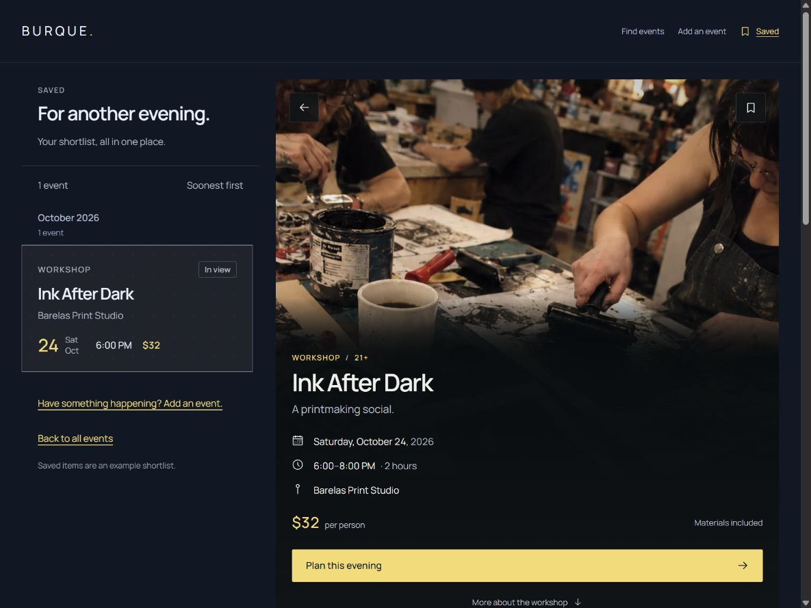
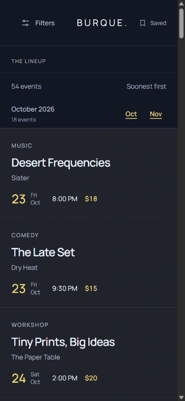

# Saved layout and Tide typography · Lineup 2.0.5

This application-only patch resolves initial audit findings **L01** and **L02**. Tide UI 1.10.0 remains the source of truth; none of its source files, tests, tokens, recipes, registry or assets changed. Root/site/tooling sources are also unchanged. Layout family remains option 1.

## Saved layout

The non-filter workspace has two explicit tracks. `src/styles/desktop.css` now places its result list in column 1 and event detail/placeholder in column 2. Filter/list/detail browse pages retain their existing scoped placement in columns 2/3 and their 20/35/45 proportions. The fix introduces no new breakpoint or duplicate content.

Saved uses its authored 22rem track at the 75rem breakpoint and the existing 390px track from 90rem. Measurements were 390px at 1199px, **352px at 1200px**, and **390px at 1440/1920px**. Both tracks are populated, the list starts at the workspace inset, and detail follows its gap. The old 1200px list was 117.6px wide. Separate intrinsic intro/summary rows and the bounded native feed remain intact; the detail document scrolls naturally.

## Component typography

`lineup-summary.html` now composes a private summary wrapper containing the optional context wrapper and a canonical `tide-results` sibling. The context does not share the Results element. Result count/order and month header/title/count use only their kit-owned slots. `results-intro.html` and submission retain canonical Page intro classes; private aliases no longer change their type. The calendar year inherits the canonical month title instead of a private caption role.

| Role | Rendered kit and application type |
| --- | --- |
| Result count/order, month title | 14px / 24px |
| Month count | 12px / 20px |
| Page-intro title | 28px / 36px |
| Page-intro supporting copy | 14px / 24px |
| Card title | 24px / 32px |
| Card category | 12px / 20px |
| Date day | 26px / 32px |

Results retains Tide's 16px/24px block/inline padding and neutral top hairline. Month headers retain 8px/24px padding and their neutral bottom hairline. Page-intro title/supporting-copy margins come from Tide. Existing application viewport placement, reading measure and flush filter-rail inset remain private. Navigation/helper adoption is separate audit finding L06 and is not included in this patch.

## Native scrolling and regression guards

The isolated feed remains below the permanent summary. Its outer-document target clearance now reserves the context wrapper's 56px plus the canonical Results row, using existing tokens. Saved reserves the canonical one-line Page intro instead. No kit styling, runtime measurement or browser JavaScript is introduced. The current authored label/title/order strings fit the reserved rows at split-layout widths; recheck the offset if future content wraps or the recipe changes.

At 1200/1440px, all ten theme/modes aligned November to the feed top while leaving the summary at y=117px and outer scrollY=0. Saved's October fragment also aligned at 1200/1440/1920px without moving the outer page. The phone month link and native filter Reset/Escape/focus return were exercised separately.

`tools/test_presentation.py` joins private aliases to shared classes in all 64 rendered routes and checks their type declarations against the kit ownership contract. Deliberate result-count, month-title and ancestor-copy overrides must be rejected. This closes the selector-only loophole exposed by L02 without changing the UI kit's tests or contracts. Browser comparisons separately check actual computed styles and geometry.

## Verification and limits

Current-run browser coverage: in-app Chromium on Windows, 150 theme/route/width comparisons against the canonical kit, 72 representative route/breakpoint cases at 320/390/768/960/1024/1199/1200/1440/1920px, 40 desktop native month jumps, three Saved fragment loads, a phone month jump and phone filter interactions. Comparison covers family, style, size, weight, leading, tracking, case and color, plus Results/calendar-header padding and borders. No typography differences, document overflow, summary/feed overlap or Saved placement failures were found in those cases. A computed-style comparison can inspect a hidden recipe; it does not establish its discoverability or reading order.

Detailed measurements, unchanged-source fingerprints and final build/check results are in the [verification record](verification/saved-typography.json). Expanded matrices and routine screenshots are local ignored artifacts in `build/qa/lineup-2.0.5/`. Build and normal checks are run from the repository root; evidence-record-only updates are followed by a rebuild/freshness check.

Native Firefox/Safari, physical devices/software keyboards, screen readers, zoom/text enlargement, forced colors, reduced-motion interaction, print and exhaustive state testing remain unverified in this pass. No accessibility-conformance claim is made. Initial audit findings **L03–L06** remain open: narrow-screen heading placement, venue scope/recovery, historical page titles and navigation/helper reuse. Their historical screenshots remain preserved in the audit.
