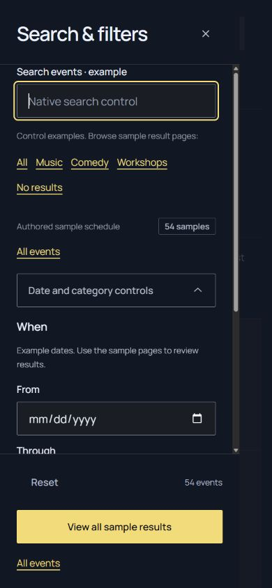
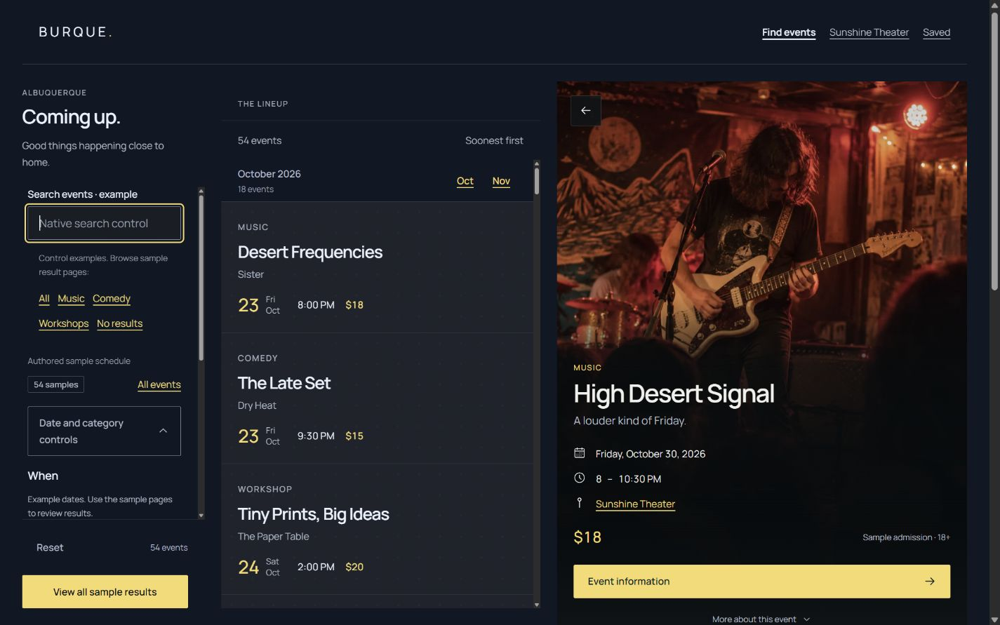

# Tide alignment complete · Lineup 2.1.3

**This task is complete.** Lineup consumes Tide UI 1.10.0's actual HTML recipes and shared CSS. The application has no private component typography, decoration, focus-ring or internal-spacing overrides. Personalizing Lineup's layout or behavior is a separate task; it is not unfinished alignment work. Tide, its distribution, the reference site and shared tools are unchanged.

## Completion boundary

- Every route uses registered Tide primitives and recipes. Labels and controls share the canonical Field wrapper; buttons, choices, uploads, hints and legends use their real public classes. Event cards use the current category slot and metadata structure, without retired invisible separators. The filter footer uses the canonical `footer` element directly inside its panel.
- The five application stylesheets own host composition only. They do not define typography, shared tokens, component colors, borders, scrims, internal padding/gaps or focus appearance, including through private aliases and ancestor selectors.
- The shared component cascade matches the same authored component HTML loaded with Tide CSS alone, across all routes and representative theme/viewport states. Content, heading levels, native IDs, routes, optional component slots and supported modifiers remain appropriate to each application context.
- Native controls, keyboard paths, venue scope and responsive panes retain their established contracts. Build, ownership, markup and interaction checks pass.

The boundary does not require identical page arrangements or sample copy to Tide's documentation specimens. Lineup's column widths, external wrappers, placement, collapse points, native scrolling, fragment clearance and drawer motion remain application composition. They do not alter the component interiors.

## Changes that finish alignment

| Area | Canonical adoption |
| --- | --- |
| Search | `tide-field` contains both `tide-field__label` and `tide-field__control`. Removed the private caption-size/secondary-color label. |
| Filter groups | `tide-fieldset tide-stack` follows the current Controls recipe; removed the private fieldset grid/gap override. |
| Links and small text | Ordinary `tide-link` inherits canonical body type. Schedule/supporting copy and the site footer use `tide-caption`; no private 12px links or 11px footer. |
| Hero/details | Restored Tide's 40svh content reserve, scrim, padding and print presentation. Removed private photo-reserve, background and safe-area interior overrides. |
| Focus | Removed the rail's inward focus-ring override. Private search/disclosure wrappers reserve 8px outside controls on desktop; Tide draws its normal outward rings. |
| Header | A private outer wrapper owns sticky placement/canvas. The public `tide-site-header` owns its complete padding, navigation and appearance. |
| Starter overview | A private outer host supplies page width/padding around the canonical Stack helper; the overview markup participates in the strict presentation guard. |
| Cards/footer | Current `tide-event-card__category` and separator-free metadata; semantic `tide-filter-panel__footer`. Removed the phone override of the selected-card outline. |

## Component coverage

The retained [inventory and measurements](verification/tide-alignment.json) records every public class used across all 67 routes, with its Tide recipe owner. The inventory covers 41 public component/helper families:

| Family | Tide recipes consumed |
| --- | --- |
| Navigation and actions | Site header, Brand, Skip link, Button, Photo control, Back link, Link, Icon |
| Fields and forms | Field, Fieldset, Choice, Upload, Expandable, Form section, Form actions |
| Results and calendar | Results, Event group, Event list, Event card, Date, Badge, Empty |
| Event/venue reading | Event hero, Event details, Venue profile, Summary, Schedule, Place, Inclusions, Disclosure |
| Page and content | Page intro, Page body, Content page, Prose, Notice |
| Supporting composition/text | Stack, Row, Caption, Eyebrow, Screen-reader-only text |

Remaining shared-element rules are external reading/viewport size, margin, placement, native fragment/scroll clearance and responsive availability. The filter panel root owns a native popover's external position/size/translation; its internal header/body/footer styling stays canonical. Preview-status visibility follows the paired-pane breakpoint. The private sticky canvas and its gap cover are on an ordinary wrapper, not a Tide component. No broader consumer appearance exceptions are used, even where Tide's registry still permits historical values.

`tools/presentation_contract.py` and the presentation tests enforce this stricter application boundary. Negative fixtures exercise lookalike type, inherited color, private aliases, generic descendants, focus overrides, shared tokens and internal spacing. Rendered markup checks cover all routes, canonical field nesting/primitives, current card slots and the semantic/direct-child filter footer. Existing shared contracts remain unchanged.

## Verification

Chromium on Windows:

- All 67 routes at 390×900, 1024×900 and 1440×900: **201 Tide-only cascade comparisons, zero differences**.
- Ten representative routes spanning every component family in each of five themes × light/dark at those three widths: **300 more comparisons, zero differences**.
- Starter overview at the same three widths: **three additional comparisons, zero differences**; its heading and document overflow also pass.
- Each comparison inspects 43 computed type, color, decoration, border, padding, gap, focus and internal-layout properties on public elements and unclassed recipe descendants. Private-only composition wrappers are excluded; inline-flex blockification and documented host visibility are normalized. This is component-interior parity, not a page-size equality test.
- **223 layout cases**: every route at 1024/1440, ten representative routes at 320, 390, 768, 959, 960, 1199, 1200 and 1920, plus three pane layouts at 1024/1200/1440×500. One visible h1, no horizontal document overflow, and at least 24px bottom clearance in bounded layouts.
- Native phone drawer: canonical search label, visible outward input focus, scrolling body/pinned footer, keyboard order from last checkbox to Reset/action, native query/date/category Reset, Escape and focus return. Desktop input focus has 8px start and 34px end clearance around Tide's ring.
- Venue Reset returns to six exact `sunshine-theater` cards; Comedy stays scoped and empty while retaining venue information; recovery returns to the same venue's results.
- Resizing an open drawer to desktop exactly fits its reserved column, retains the original query/control set, and returns to a hidden closed drawer on phone after native dismissal. Month fragments align at the feed top without moving the desktop document; the skip link appears at 16px and focuses Results. Submission Reset restores the eleven canonical controls.

The evidence records final root build/check results, application tests and source fingerprints. `tools/presentation_reference.py`, run after `npm run build`, regenerates ignored Tide-only probes for browser inspection without editing dependencies. Expanded measurements live under ignored `build/qa/lineup-alignment/`.

Browser evidence is Chromium, not Firefox/Safari, physical-device or screen-reader coverage. Those testing limits do not represent known remaining component drift. Future Tide changes require a new compatibility review; future Lineup personalization must preserve this adoption boundary.

