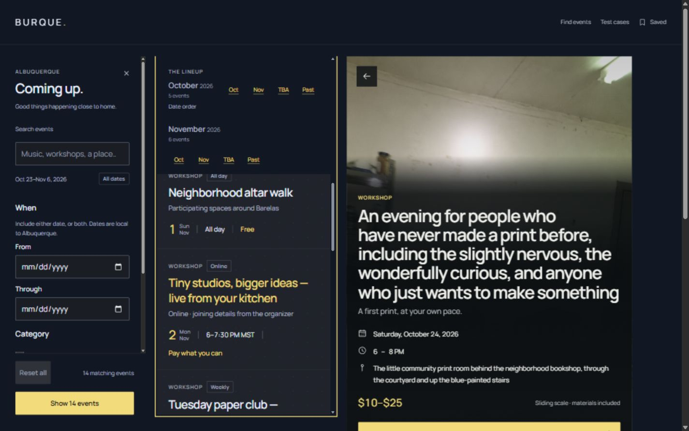
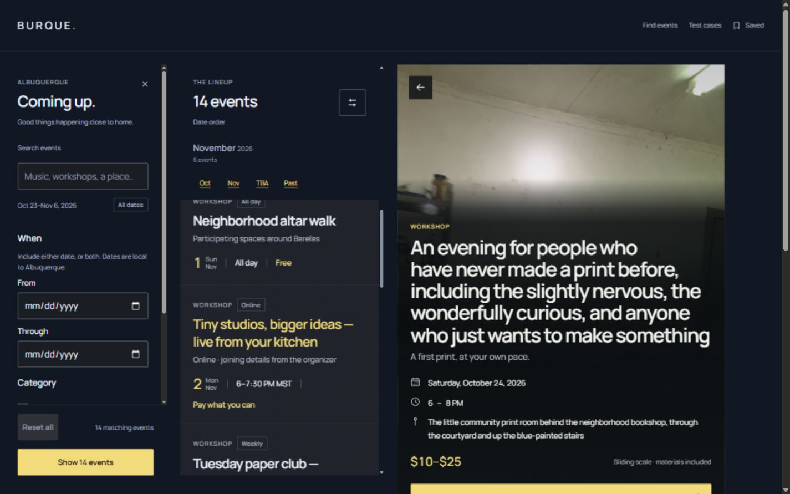
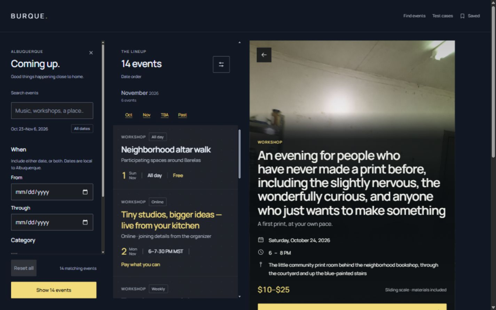
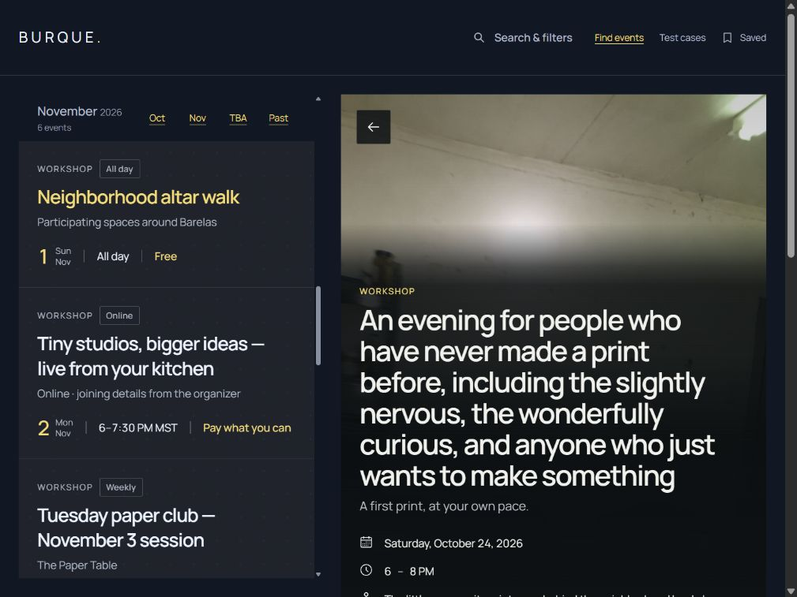
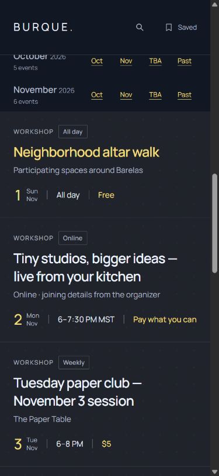

# Sticky month handoff — focused audit and correction

Scope: the calendar label leaving the top of the event list while the next group arrives. Captured and verified in the connected Chromium browser on Windows, 2026-10-24. This correction is pressure-test experiment 0.1.1; the approved baseline and kit remain frozen.

The user subsequently accepted this fix for preservation and the next app release. See the [accepted behavior and integration contract](../../../release-handoffs/STICKY-HEADINGS.md). Acceptance does not change the frozen baseline or UI kit, and does not approve the other pressure-test compositions.

## 1. Desktop before — confirmed overlap

At 1440 × 900, list scroll position 1334.6666px, the fixed summary spans y117–249. The outgoing October header spans y157–217 and paints over the 14 events count and filter control. A hit test at the summary's count area returns the month header. Its z-index is 5; the summary's is 3.

Strength: the next month replaces the previous one without needing extra interaction. Issue: the outgoing month competes with the permanent list controls. Accessibility risk: it can visually hide the count and cover a pointer target. This observation does not establish full keyboard or assistive-technology coverage.

## 2. Desktop after — correct hierarchy

At the same viewport, scroll offset and exact element rectangles, the summary is now on top. October recedes behind it and November remains below. Date-group stickiness, card flow, list height, gap, footer alignment and right-side document scrolling are unchanged.

The feed wrapper now has the private class `tide-pressure__feed` with `isolation: isolate`. Its calendar labels and cards share a local stacking context below the sibling summary. The change adds no scroll container, clipping rectangle, arbitrary elevated z-index or JavaScript scroll listener. This corrects host composition layering, rather than changing the calendar component or primitive tokens.

## 3. Reverse and partial handoff — healthy

Four native scroll samples on either side of the boundary cover scroll positions 1273.3334, 1304, 1386 and 1304px. At each position, the summary label, count and filter-control hit points resolve to the summary. Group headers retain their normal push-off movement. One sample leaves the outgoing October header partly in the calendar area; only the portion below the summary is visible.

## 4. Tablet — existing layout retained

At 1024 × 768, November navigation leaves the month header at the top of the bounded list (y121), below the app header (bottom y97). The app header remains on top, no horizontal overflow occurs, and the filter drawer starts closed.

## 5. Phone — existing layout and drawer retained

At 390 × 844, October passes behind the persistent app header while November enters below it. No horizontal overflow occurs. Search and filters opens the modal, places focus on its heading and closes with Escape. The feed isolation remains below the modal and header.

## Ownership and limits

`tools/build.py` supplies the private feed class in the 14-case dataset and recovery pages; `css/pressure.css` owns its rule. The copied legacy secondary samples are outside this pressure-test composition. The same stacking conflict exists in the inherited host CSS, which is byte-identical to the baseline, so a future accepted host release should carry this hierarchy contract. No frozen baseline/kit file is changed here.

Observed geometry and hit tests are in [checks.json](checks.json). Source/preservation checks cover all 283 approved baseline files and earlier frozen inventories. The immutable 0.1.0 study archive is retained alongside the 0.1.1 snapshot. Firefox, Safari, physical-device and screen-reader checks remain outside this verification scope.
