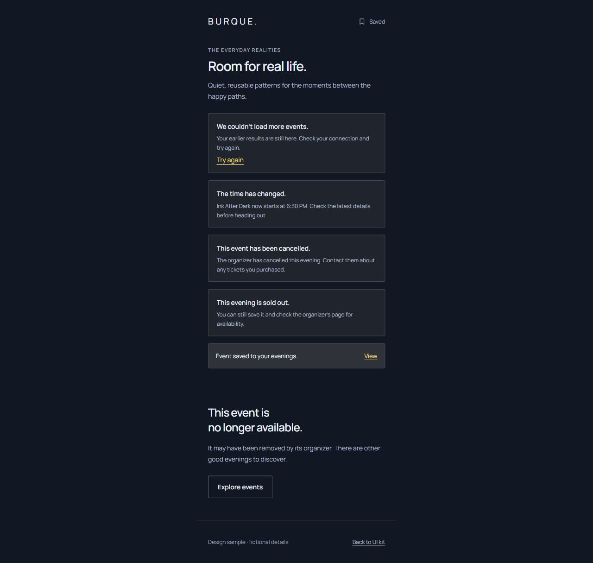
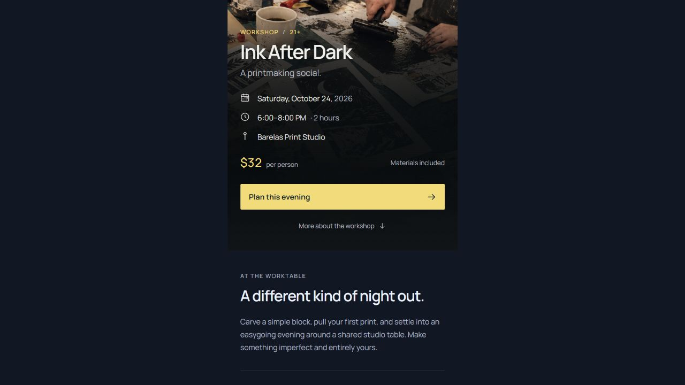
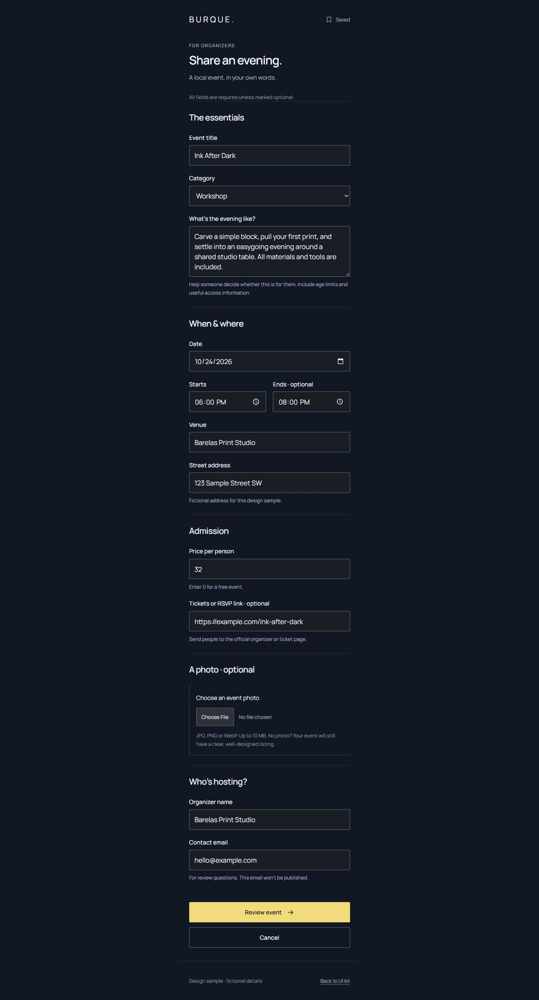

# Shared Filters baseline — real-data readiness review

Date: 24 October 2026. Accepted baseline: Tide kit1.3.0, shared-filter consumer release1.0.0. The user approved the release and asked to preserve it before reviewing missing components/screen states. This review changes no kit or product screen.

The complete release is locked in `../locks/shared-filter-release-1.0.0.json` (283 files), including the existing archives. Its source/package inventory is verified read-only by `preserve.py`. Future implementations belong in a successor or sibling copy; do not add specimens, QA or docs inside the frozen baseline. The previous approved prototype, earlier app/kit and design studies remain preserved too.

## Verdict and scope

The kit can be used to start testing real event data now. A public live-data experience still needs consistent state treatments around the existing components. There is no demonstrated reason to replace its type, spacing, palette, cards or desktop composition.

This is a coverage review of the local HTML/CSS kit and its documented host boundary, not a CMS/backend or release-certification audit. Source evidence: component manifest (22 components),15 frame templates, Components/Adoption/Search-filter contracts, screen map, and the consumer's end-of-feed/preview behavior. Three current Bumble Dark specimens were captured and inspected in the in-app Chromium browser. Other modes were not visually re-audited in this run. The browser inspection is read-only, not a new interaction test suite.

Already covered: buttons, field/choice states, badges, notices, native disclosure, calendar groups, shared filter panel, applied/empty search, saved and saved-empty layouts, poor/missing photos, long titles, prose/help layout, submission/review/received layouts, plus static cancelled/sold-out/changed-time/retry/unavailable examples.

## Recommended coverage, in order

| Priority | Gap | Current coverage | Add next | Reusable home |
| --- | --- | --- | --- | --- |
|1|Real event metadata|A fully specified single evening; guidance says not to invent unknown values|Overnight, multi-day, all-day, recurring occurrence, time TBA; free/range/donation/unknown price; online/hybrid/location TBA; missing practical details|Date, Card, Hero facts, Details, Place, Badge. Document conditional rendering and accessible date labels; new composed fixtures, no new primitive.|
|2|Event lifecycle in context|Standalone cancelled, changed-time, sold-out and unavailable specimens|Show those states on both actual feed rows and detail pages. Add postponed/new date unknown, rescheduled with old/new time, ended/archive and unavailable selected preview. Define the matching attendance/save/calendar actions|Existing Badge, Notice, Button, Empty and event compositions. Cancellation is text and action behavior, not color alone.|
|3|Loading and recovery|Static load-more failure/retry notice and no-results recovery; local synchronous matching|Initial feed loading, detail loading/failure, stale/offline-with-cached-content, failed first load, retry, and truly no upcoming events distinct from no filter matches|Existing Notice, Empty, Result summary and Button; add one consistent pending/progress state contract. Keep existing content visible where useful; host owns async work.|
|4|Attendance and utility actions|Generic Plan this evening; optional ticket URL in submission; organizer/contact styles|Get tickets, RSVP, free/no-booking-required, Visit organizer, unavailable/sold-out treatment; Directions, Share/copy link and Add to calendar with success/failure feedback|Button/Link, Organizer/Place, Notice/Toast. A compact actions composition is sufficient until a menu is actually needed.|
|5|More than one data batch|Long48-event feed, month jumps and sample end-of-feed|Choose a load-more or page-link pattern. Show fetching, failed next batch, retry, end-of-results and correct count wording. Preserve list focus, selection and scroll|Button, Result summary, Notice; composed feed-footer specimen. A separate Pagination block is justified only if page-number navigation is selected.|
|6|Saving an event|Static selected control, saved list, saved-empty and saved message specimens|Unsaved/saved, saving, failed save/unsave, optional Undo, and a saved event subsequently changed/cancelled/removed|Existing Icon button/Button and Toast/Notice/Badge; state and focus/announcement contract. Cross-device accounts are a later product decision.|
|7|Submission and uploaded media, if public submissions are enabled|Native fields/upload guidance plus review and received layouts|Form-wide error summary linking to invalid fields; submitting and failure-with-values-preserved; selected photo preview/remove, unsupported/oversized/unreadable file and image-load fallback|Field errors, Upload, Notice, Button and existing Fallback. A reusable Error summary is the clearest new block candidate. Form names/serialization, validation and upload processing stay with the host.|
|8|Corrections and reporting, if enabled|Organizer contact and generic prose/forms|Report an incorrect time, cancellation or broken link; acknowledge the report without making the user resubmit; organizer edit/cancel confirmation when those features exist|Field, Choice, Button, Notice, content-page layout. A generic Dialog may earn a shared home once a concrete confirmation flow exists; the filter panel alone is not that API.|

For a read-only public feed, prioritize1–5. Saving adds6. Public submissions add7, then the correction/report path in8. Administration screens, accounts, reminder settings and full organizer dashboards are separate product scope; they do not block evaluating real event data in this kit.

## Likely additions to the shared inventory

Most rows are documented compositions or variants. Two narrowly scoped additions deserve evaluation: an Error summary for forms with several invalid fields, and a shared pending/progress treatment (including busy Button/region examples). A standalone progress block is only necessary if reused beyond one button or notice. Skeletons are optional; meaningful loading wording and stable content are enough for the first pass.

Each accepted addition needs a registry/CSS/HTML/state home, six theme/mode specimens, and a copied consumer that removes any duplicated styling. Add action semantics, keyboard/focus behavior and announcement expectations alongside the visual example. Preserve the baseline throughout.

## Current capture walkthrough

1. **Status and recovery specimens.** Existing notices already express cancellation, time change, sold-out, retry and removal clearly with text and neutral borders. The gap is composing them into a real event's feed/detail/actions and lifecycle. A static saved toast is appearance evidence, not proof of save behavior or live-region delivery.

2. **Event details, scrolled to facts and primary action.** The facts/reading hierarchy is reusable. The source shows a known local date/time, one fixed price and one venue. Missing data/complex date examples and event-specific attendance actions need explicit specimens rather than guessed copy. This screenshot was captured at the actual viewport after native scrolling; a full-page capture that expanded the viewport-sized hero was rejected and replaced.

3. **Submission specimen.** Visible labels, optional-field wording, native controls, grouped fields and format/size guidance already exist. The current source has no global error summary or selected/uploading/rejected-file variants, and review/received are static layouts. Native control semantics are a useful starting point; screenshot inspection alone cannot verify keyboard validation or screen-reader announcements.

## Accessibility and evidence limits

Keep unknown information explicit and optional facts conditional; missing price must not become Free, and missing end time must not become an invented duration. Do not make event status depend only on color. Preserve meaningful action names when state changes; failed actions need a visible recovery.

For multi-error forms, clear overall feedback and field-level correction guidance should work together. See [W3C WAI form notifications](https://www.w3.org/WAI/tutorials/forms/notifications/). For asynchronous regions, the pending-state contract should account for completion and announcement timing; [MDN aria-busy](https://developer.mozilla.org/en-US/docs/Web/Accessibility/ARIA/Reference/Attributes/aria-busy) describes signalling an incomplete update. These sources inform recommended behavior, not a claim that those behaviors are already shipped or tested here.

No full accessibility compliance claim is made. Keyboard/zoom/reduced-motion and assistive-technology checks are needed for new state implementations. Firefox/Safari remain deferred at the user's request; physical devices, software keyboards and a backend were not tested in this review. The preserved release's earlier QA is history, not fresh audit evidence.

Recommended next step: create a small real-data resilience specimen set for priorities1–3 in a sibling copy, keeping the accepted baseline fixed.
